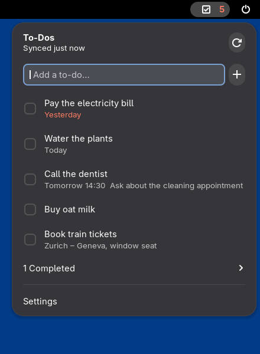
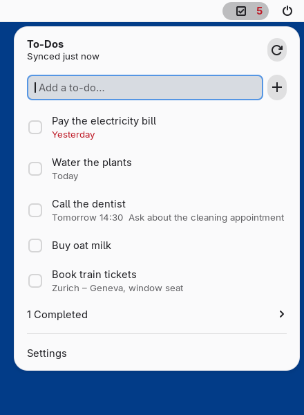
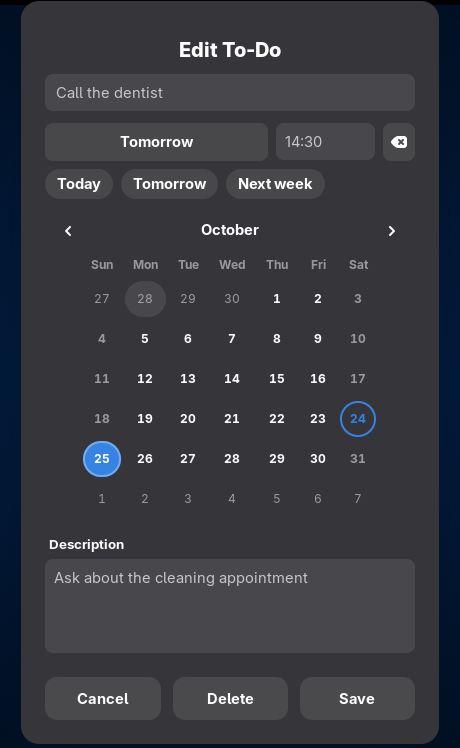
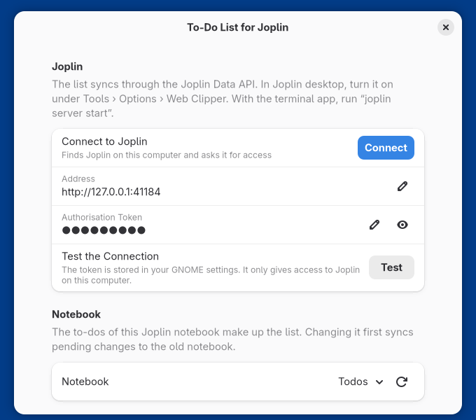

# To-Do List for Joplin

A GNOME Shell extension that puts a to-do list in the top bar and keeps it in
sync with a [Joplin](https://joplinapp.org) notebook. Each to-do has a
**title**, an optional **due date** (with an optional time) and an optional
**description**.

<p>
  
  
</p>
<p>
  
  
</p>

## Features

- Add a to-do straight from the menu: type a title and press Enter. The **+**
  button opens the full editor.
- Due dates from a calendar or the Today / Tomorrow / Next week shortcuts, with
  an optional time. Overdue items turn red, and the top bar shows how many are
  open.
- Multi-line descriptions. They are the body of the Joplin note.
- Tick a to-do off with its checkbox. Completed ones collect in a submenu, and
  can be cleared in one go.
- Two-way sync with one Joplin notebook. The list keeps working while Joplin is
  closed and catches up when it's back.

## Requirements

- GNOME Shell 50 or 51
- Joplin 3.x, either:
  - **Joplin desktop** with its Web Clipper service turned on
    (Tools › Options › Web Clipper › Enable Web Clipper Service), or
  - the **Joplin terminal app** running `joplin server start`

The extension talks to Joplin through the
[Joplin Data API](https://joplinapp.org/help/api/references/rest_api/), the
local service behind the Web Clipper. Joplin's own sync then carries the
to-dos to your other devices.

## Installation

From a clone of this repository:

```sh
make install
```

Log out and back in, then enable the extension in the Extensions app or with
`gnome-extensions enable todo-list@theblackprism.ch`.

`make pack` builds `build/todo-list@theblackprism.ch.shell-extension.zip`,
which `gnome-extensions install --force <zip>` installs as well.

## Connecting to Joplin

Open the extension's settings (from the menu's **Settings** item) and click
**Connect**. The extension finds Joplin on this computer and asks it for
access. Approve the request in the dialog that Joplin desktop shows.

With the terminal app, which can't show that dialog, enter the address and the
token yourself:

```sh
joplin config api.token    # prints the token
joplin server start        # serves the Data API on http://127.0.0.1:41184
```

**Test the Connection** checks both.

## How syncing works

- **Notebook.** The list shows the to-dos of one notebook. By default that's a
  top-level notebook called "Todos", created on the first sync. You can choose
  another one in the settings; changes still waiting to be synced go to the
  old notebook first.
- **Fields.** The title and description become the note's title and body. The
  body is Markdown in Joplin and shown as plain text here. Completion maps to
  Joplin's to-do completion.
- **Due dates and alarms.** Joplin turns a to-do's due date into an alarm on
  desktop and on phones. A due date without a time is stored at **09:00** on
  that day, so the reminder comes in the morning. Any due time of exactly
  09:00 is therefore shown as a date without a time.
- **When.** The extension syncs when it starts, every few minutes (5 by
  default), two seconds after you change something, and when you open the menu
  if the last sync is older than half a minute. Until Joplin is reachable,
  changes are kept in `~/.local/share/todo-list@theblackprism.ch/todos.json`.
- **Changes on both sides.** Merging works field by field, so a title changed
  here and a description changed in Joplin both survive. If both sides changed
  the same field, the more recent change wins.
- **Deleting.** Deleting a to-do moves its note to Joplin's trash, so it can
  be restored there. If a note was edited in Joplin after you deleted it here,
  the edit wins and the to-do comes back. A note deleted in Joplin disappears
  here, unless you had edited it here in the meantime. A note moved to another
  notebook, or turned into a plain note, leaves the list.

The token is stored in your GNOME settings (dconf), much like Joplin keeps it
in its own settings file. It only gives access to the Data API on this
computer.

## Development

The extension's files are in `src/`, and exactly those go into the zip.

```
src/lib/       sync core and Joplin client (no GNOME Shell imports; shared with the preferences)
src/ui/        top-bar menu, edit dialog, date picker
src/prefsPage.js  the preferences window
tests/unit/    Node tests of the sync core, against an in-memory fake of the Data API
tests/gjs/     GJS tests of the HTTP client, file store, sync manager and preferences
tests/shell/   a script that drives a real, headless GNOME Shell
```

```sh
npm ci
npm run lint
npm test                      # sync scenarios and seeded random interleavings
make test-gjs                 # needs gjs and libsoup 3; starts a fake Joplin
tests/run-shell-smoke.sh      # needs GNOME Shell 50+; runs it headless
```

`tests/run-shell-smoke.sh` installs the extension into throwaway directories,
starts `gnome-shell --headless` and clicks and types through the menu, the
dialog and the preferences. It takes screenshots, and it fails on any
JavaScript error from the extension. It never touches your own to-dos or
settings. Set `SMOKE_JOPLIN_URL` and `SMOKE_JOPLIN_TOKEN` to use a real Joplin
instead of the fake one.

To test GNOME versions your system doesn't have, `tests/chroot/` builds
throwaway roots (run as root):

```sh
tests/chroot/setup-ubuntu-50.sh /srv/gnome50   # Ubuntu 26.04, GNOME Shell 50
tests/chroot/setup-arch-51.sh /srv/gnome51     # Arch Linux, GNOME Shell 51
tests/chroot/run-gjs.sh /srv/gnome51
tests/chroot/run-smoke.sh /srv/gnome51         # screenshots end up in build/
```

`make pot` extracts the translatable strings into `po/`.

## License

GPL-3.0-or-later. See [LICENSE](LICENSE).
